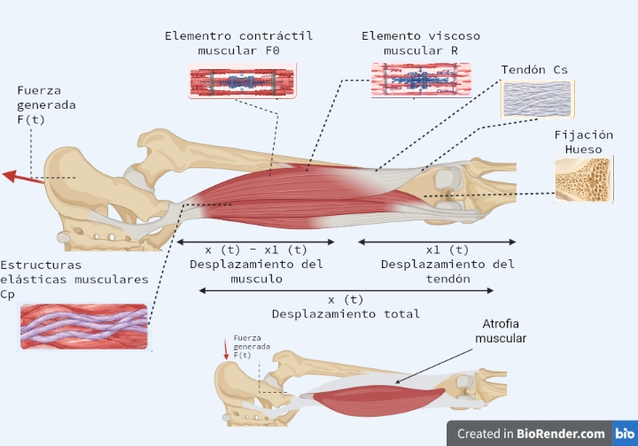
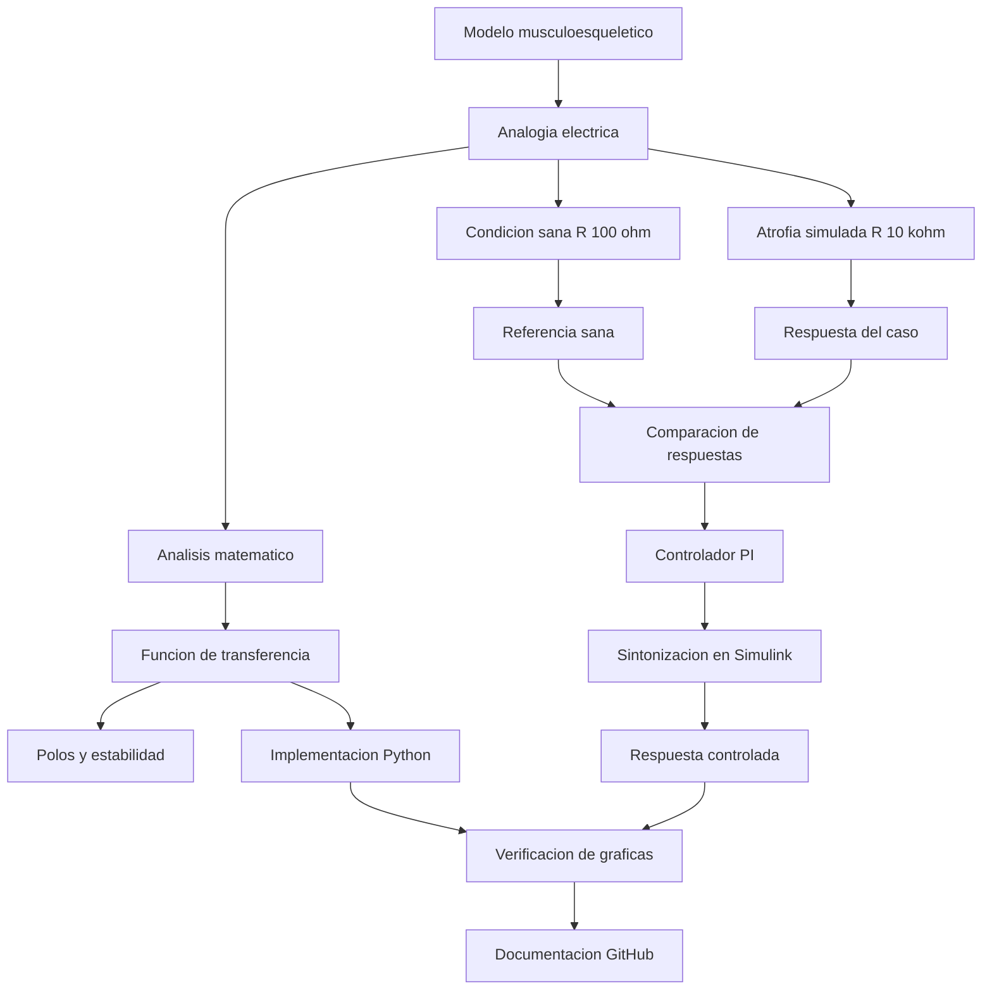

[](https://matlab.mathworks.com/open/github/v1?repo=l23212242-alt/MSFP3)

# Práctica 3 — Modelo y control del sistema musculoesquelético

Repositorio académico de **Modelado de Sistemas Fisiológicos**, correspondiente a **Ingeniería Biomédica** del Tecnológico Nacional de México / Instituto Tecnológico de Tijuana. La práctica aborda la representación de un sistema musculoesquelético mediante una analogía eléctrica, la obtención de su modelo matemático, el análisis de estabilidad y la comparación de un individuo de referencia con un caso de **atrofia muscular simulada**. Se incorpora un controlador **PI** y se reproducen las respuestas mediante MATLAB/Simulink y Python.

El caso de referencia emplea una resistencia equivalente de **100 Ω**, mientras que la condición simulada de atrofia utiliza **10 kΩ**, representando una modificación del amortiguamiento viscoso del modelo. La respuesta del individuo sano sirve como referencia para evaluar la respuesta controlada.

**Docente:** Dr. Paul Antonio Valle Trujillo  
**Correo:** paul.valle@tectijuana.edu.mx  
**Departamento:** Ingeniería Eléctrica y Electrónica  
**Institución:** Tecnológico Nacional de México / Instituto Tecnológico de Tijuana  
**Asignatura:** Modelado de Sistemas Fisiológicos  
**Programa:** Ingeniería Biomédica  
**Estudiante:** Javier Vazquez Gomez · 23212242 · l23212242@tectijuana.edu.mx  

**Repositorio de la asignatura:** https://github.com/DrPaulValle/MSF-IBF1020  
**Sede:** Blvd. Alberto Limón Padilla s/n, Tijuana, C. P. 22454, B. C., México.

---

<a id="contenido"></a>
## Contenido

1. [Resumen](#resumen)
2. [Competencia y objetivos](#objetivos)
3. [Relación con el temario](#temario)
4. [Modelo físico y analogía eléctrica](#analogia)
5. [Formulación matemática](#modelo)
6. [Análisis temporal y de estabilidad](#analisis)
7. [Señales de entrada y condiciones de simulación](#senales)
8. [Implementación en MATLAB, Simulink y Simscape](#matlab)
9. [Control en lazo cerrado y sintonización PI](#pid)
10. [Reproducción en Python](#python)
11. [Controlador analógico y laboratorio](#laboratorio)
12. [Resultados y verificación cruzada](#resultados)
13. [Flujo de trabajo](#flujo)
14. [Actividades del estudiante](#actividades)
15. [Estructura del repositorio](#estructura)
16. [Requisitos](#requisitos)
17. [Reproducibilidad y entregables](#reproducibilidad)
18. [Referencias](#referencias)

---

<a id="resumen"></a>
## Resumen

Se estudia un modelo simplificado del sistema musculoesquelético en el que la **elasticidad del tendón** y la **elasticidad pasiva del tejido conectivo muscular** se representan mediante elementos capacitivos, mientras que el amortiguamiento viscoso muscular se asocia con una resistencia. Se consideran una fuerza de entrada $F(t)$, una fuerza activa relacionada con el elemento contráctil y una fuerza transmitida $F_s(t)$. El modelo se utiliza para comparar la condición de referencia y un caso de atrofia representado por un incremento de la resistencia.

El desarrollo incluye el análisis matemático del circuito equivalente, la función de transferencia, la estabilidad de la planta, la simulación de una señal rectangular y el diseño de un **controlador proporcional-integral (PI)**. La respuesta de la condición alterada se contrasta con la del individuo sano, utilizando las gráficas obtenidas en MATLAB y Python.

**Palabras clave:** sistema musculoesquelético; atrofia muscular; analogía eléctrica; amortiguamiento viscoso; elasticidad; controlador PI; MATLAB; Simulink; Python; simulación *in silico*.

[Volver al contenido](#contenido)

---

<a id="objetivos"></a>
## Competencia y objetivos

### Competencia a desarrollar

Aplicar los fundamentos del modelado matemático y del control retroalimentado para describir y analizar el comportamiento dinámico de un sistema musculoesquelético simplificado, interpretando la correspondencia entre parámetros eléctricos y propiedades mecánicas de tejidos biológicos.

### Objetivo general

Modelar y simular la respuesta de un sistema musculoesquelético ante una fuerza de entrada, comparar el comportamiento de referencia con un caso de atrofia muscular simulada y evaluar la acción de un controlador PI mediante herramientas computacionales.

### Objetivos específicos

- Identificar los elementos contráctiles, el amortiguamiento viscoso y las elasticidades representadas en el circuito equivalente.
- Formular las relaciones matemáticas del modelo y analizar su función de transferencia.
- Examinar la estabilidad de la planta mediante sus polos.
- Comparar la respuesta del individuo sano ($R=100\,\Omega$) con la del caso simulado ($R=10\,\mathrm{k}\Omega$).
- Aplicar una señal rectangular de entrada en un intervalo de simulación de diez segundos.
- Sintonizar un controlador PI y registrar sus ganancias proporcional e integral.
- Representar gráficamente la entrada, la referencia, el caso alterado y la respuesta controlada.
- Contrastar los resultados obtenidos en MATLAB/Simulink y Python y documentar los archivos de la práctica.

[Volver al contenido](#contenido)

---

<a id="temario"></a>
## Relación con el temario

La práctica retoma conceptos de modelado de sistemas fisiológicos y de control:

| Unidad | Área | Contenidos aplicados |
|---|---|---|
| I | Sistemas de control retroalimentados | Señales de entrada, comparación de respuestas, error y estabilidad |
| II | Modelado matemático | Analogías mecánico-eléctricas, formulación de ecuaciones y función de transferencia |
| III | Controladores | Retroalimentación, controlador PI y sintonización de ganancias |

La interpretación fisiológica se centra en las propiedades pasivas del músculo y del tendón y en el efecto de modificar el amortiguamiento equivalente.

[Volver al contenido](#contenido)

---

<a id="analogia"></a>
## Modelo físico y analogía eléctrica

El diagrama biológico distingue el **individuo sano** del **caso de atrofia muscular simulada**. En el segundo se representa un músculo de menor volumen; en la simulación la diferencia entre ambos casos se introduce aumentando $R$, sin afirmar que esa resistencia constituya una medición clínica directa de atrofia.



| Símbolo | Elemento del modelo | Interpretación |
|---|---|---|
| $F(t)$ | Fuente de excitación | Fuerza aplicada al sistema, representada por una señal eléctrica |
| $F_0(t)$ | Elemento contráctil | Componente activo del músculo |
| $F_s(t)$ | Salida del sistema | Fuerza transmitida en la representación del modelo |
| $R$ | Resistencia | Amortiguamiento viscoso equivalente del tejido muscular |
| $C_g$ | Capacitancia | Elasticidad del tendón, según el esquema de la práctica |
| $C_p$ | Capacitancia | Elasticidad pasiva del tejido conectivo muscular |
| $\alpha$ | Factor del modelo | Coeficiente empleado en la formulación de la fuerza activa |

### Parámetros utilizados en las simulaciones

| Parámetro | Individuo sano | Atrofia simulada | Representación |
|---|---:|---:|---|
| $R$ | $100$ | $10\,000$ | $\Omega$ |
| $C_g$ | $10$ | $10$ | $\mu\mathrm{F}$ |
| $C_p$ | $100$ | $100$ | $\mu\mathrm{F}$ |
| $\alpha$ | $0.25$ | $0.25$ | Adimensional |
| $F_0$ | $1$ | $1$ | Amplitud de entrada en la simulación |

Las capacitancias y resistencias corresponden a la **analogía eléctrica empleada en el código**. No se deben interpretar como conversiones directas a unidades mecánicas sin una escala de equivalencia definida.

[Volver al contenido](#contenido)

---

<a id="modelo"></a>
## Formulación matemática

### 1. Relaciones del circuito equivalente

El análisis matemático adjunto separa el circuito mediante superposición para estudiar las contribuciones de las fuentes. En la primera parte se establece la suma de corrientes equivalentes y se emplean las relaciones constitutivas de los elementos resistivos y capacitivos. La derivación completa se conserva en [`Analisis Matematico(1).pdf`](Analisis%20Matematico%281%29.pdf).

Para la contribución de la fuente de entrada se obtiene la expresión de referencia:

$$
\frac{F_{s1}(s)}{F(s)}=\frac{C_gRs+1}{R(C_p+C_g)s+1}.
$$

La segunda contribución, vinculada con el elemento contráctil, se combina con la primera para determinar la respuesta transmitida.

### 2. Función de transferencia

En el desarrollo matemático manuscrito se presenta:

$$
\boxed{G(s)=\frac{F_s(s)}{F(s)}=\frac{C_gRs+1-\alpha}{R(C_p+C_g)s+1}}.
$$

El código Python entregado implementa el numerador como `R * 1e-6` y `1 - alpha`, es decir:

$$
G_{\mathrm{Python}}(s)=\frac{R(10^{-6})s+(1-\alpha)}{R(C_p+C_g)s+1}.
$$

**Nota de consistencia:** el factor $10^{-6}$ usado en el numerador del programa no coincide con el valor declarado $C_g=10\times10^{-6}\,\mathrm{F}$. Se presentan ambas expresiones tal como aparecen en los materiales; antes de declarar una equivalencia exacta entre el análisis manuscrito y el código es necesario verificar cuál es la expresión definitiva utilizada en Simulink.

### 3. Representación dinámica

El denominador de la función de transferencia es de primer orden. En la representación empleada por Python, para entrada $u(t)=F(t)$ y salida $y(t)=F_s(t)$, se cumple:

$$
R(C_p+C_g)\frac{dy(t)}{dt}+y(t)
=R(10^{-6})\frac{du(t)}{dt}+(1-\alpha)u(t).
$$

Esta forma expresa la dinámica **de la función implementada en Python**, con condiciones iniciales compatibles con la simulación.

[Volver al contenido](#contenido)

---

<a id="analisis"></a>
## Análisis temporal y de estabilidad

### 1. Respuesta estacionaria

Para una entrada escalón unitario, la ganancia estática de la planta implementada es

$$
G(0)=1-\alpha=0.75.
$$

Por tanto, si se aplica una entrada constante de amplitud uno y se mantiene el tiempo suficiente, la salida de la planta en lazo abierto tiende a $0.75$ en las unidades de la representación. Este valor coincide con la altura aproximada de la respuesta de referencia durante el pulso, después del transitorio rápido.

### 2. Polos y estabilidad

El polo de la planta se determina a partir de

$$
R(C_p+C_g)s+1=0,\qquad \boxed{s=-\frac{1}{R(C_p+C_g)}}.
$$

Con $C_p+C_g=110\times10^{-6}\,\mathrm{F}$:

| Condición | $R$ | Polo aproximado | Constante de tiempo $\tau=R(C_p+C_g)$ |
|---|---:|---:|---:|
| Individuo sano | $100\,\Omega$ | $-90.91\,\mathrm{s}^{-1}$ | $0.011\,\mathrm{s}$ |
| Atrofia simulada | $10\,\mathrm{k}\Omega$ | $-0.9091\,\mathrm{s}^{-1}$ | $1.10\,\mathrm{s}$ |

Ambos polos son negativos y, por tanto, ambas plantas son estables en lazo abierto. El incremento de $R$ aumenta la constante de tiempo y hace más lenta la respuesta del caso simulado.

### 3. Interpretación de la respuesta

En la gráfica, la referencia sana se aproxima rápidamente a su nivel de respuesta durante el pulso, mientras que el caso alterado presenta una evolución más gradual y continúa decayendo después de que termina la excitación. La salida controlada se aproxima a la respuesta de referencia.

[Volver al contenido](#contenido)

---

<a id="senales"></a>
## Señales de entrada y condiciones de simulación

La señal utilizada en el código Python es un pulso rectangular de amplitud $F_0=1$ aplicado entre $t=1\,\mathrm{s}$ y $t=2\,\mathrm{s}$:

$$
F(t)=\begin{cases}
1, & 1\le t<2,\\
0, & \text{en otro caso}.
\end{cases}
$$

| Configuración | Valor |
|---|---|
| Tiempo total de simulación | $10\,\mathrm{s}$ |
| Solver de Simulink desde MATLAB | `ode15s` |
| Paso máximo de Simulink | $10^{-3}\,\mathrm{s}$ |
| Intervalo de Python | `0` a `10` s |
| Incremento del vector temporal Python | $10^{-3}\,\mathrm{s}$ |
| Entrada | Pulso rectangular de amplitud 1, duración 1 s |

Se aplica la misma señal a la condición sana y a la alterada para que la comparación dependa de los parámetros de cada modelo.

[Volver al contenido](#contenido)

---

<a id="matlab"></a>
## Implementación en MATLAB, Simulink y Simscape

El archivo [`Sistema(1).slx`](Sistema(1).slx) contiene el modelo de simulación. El cuaderno [`Vazquez23212242(1).mlx`](Vazquez23212242(1).mlx) abre el modelo, establece los parámetros de ejecución y recupera las señales para elaborar la figura comparativa.

### Ejecución desde el cuaderno MATLAB

```matlab
clc; clear; close all; warning('off','all')
open_system('Sistema')
parameters.StopTime = '10';
parameters.Solver = 'ode15s';
parameters.MaxStep = '1e-3';
x = sim('Sistema',parameters);

plotsignals(x.t,x.F,x.Fsx,x.Fsy,x.PID,'Control y caso')
```

El cuaderno utiliza las señales de entrada `F`, referencia `Fsx`, caso `Fsy` y salida controlada `PID`, y exporta la gráfica mediante `exportgraphics`. Su versión de consulta está disponible en [`Vazquez23212242(1).pdf`](Vazquez23212242(1).pdf).

### Representaciones y evidencias

| Recurso | Evidencia |
|---|---|
| Modelo de simulación | [`Sistema(1).slx`](Sistema(1).slx) |
| Cuaderno ejecutable | [`Vazquez23212242(1).mlx`](Vazquez23212242(1).mlx) |
| Cuaderno exportado | [`Vazquez23212242(1).pdf`](Vazquez23212242(1).pdf) |
| Figura de MATLAB | [`Control y Caso_Matlab.pdf`](Control%20y%20Caso_Matlab.pdf) |

El material proporcionado documenta el uso de Simulink. No se incorpora una afirmación de verificación con **Simscape Electrical** independiente porque no se aportó una evidencia separada que permita confirmarla.

[Volver al contenido](#contenido)

---

<a id="pid"></a>
## Control en lazo cerrado y sintonización PI

### 1. Esquema de retroalimentación

El control busca que la respuesta del caso de atrofia simulada siga la salida del individuo sano. La diferencia entre la referencia y la salida del caso controlado se utiliza como señal de error:

$$
e(t)=F_{s,\mathrm{control}}(t)-F_{s,\mathrm{tratamiento}}(t).
$$

La ley de control PI se escribe como

$$
u(t)=K_pe(t)+K_i\int_0^t e(\tau)\,d\tau,
$$

$$
\boxed{K(s)=K_p+\frac{K_i}{s}}.
$$

### 2. Sintonización del controlador

La sintonización del controlador PI se realizó mediante **PID Tuner**. La captura del ajuste presenta los siguientes parámetros:

| Parámetro | Valor |
|---|---:|
| $K_p$ | $0.021971$ |
| $K_i$ | $41303.6113$ |
| $K_d$ | No aplica (PI) |

![Parámetros y respuesta del controlador PI]

En la respuesta **Tuned** de la captura se reportan aproximadamente $0.000583\,\mathrm{s}$ de tiempo de subida, $0.00102\,\mathrm{s}$ de establecimiento y $0.108\%$ de sobreimpulso, con estabilidad de lazo cerrado indicada como *Stable*. Estos indicadores corresponden a la respuesta de sintonización mostrada en la herramienta, no a una medición fisiológica.

### 3. Función de transferencia de lazo cerrado

En la implementación de Python, la planta del caso alterado se combina con el PI mediante retroalimentación negativa unitaria:

$$
T(s)=\frac{K(s)G_{\mathrm{caso}}(s)}{1+K(s)G_{\mathrm{caso}}(s)}.
$$

La salida controlada se calcula aplicando como entrada a $T(s)$ la **respuesta de referencia del individuo sano**, según el código suministrado.

[Volver al contenido](#contenido)

---

<a id="python"></a>
## Reproducción en Python

El archivo [`Vazquez23212242(1).py`](Vazquez23212242(1).py) reproduce la señal de entrada, construye las funciones de transferencia de ambas condiciones y obtiene sus respuestas mediante `python-control` y la función `forced_response`.

El programa desarrolla las siguientes operaciones:

1. Define $F_0$, $\alpha$, $C_g$, $C_p$, las dos resistencias y las ganancias PI.
2. Construye el vector de tiempo con incremento de $1\,\mathrm{ms}$.
3. Genera el pulso rectangular entre uno y dos segundos.
4. Calcula las funciones de transferencia de referencia y del caso alterado.
5. Simula ambas salidas en lazo abierto.
6. Forma la función de transferencia del controlador PI y el lazo cerrado.
7. Calcula la respuesta del tratamiento tomando como entrada la salida de referencia.
8. Grafica las cuatro señales y guarda [`Control y Caso_Python.png`](Control y Caso_Python.png).

### Bibliotecas utilizadas

```python
import numpy as np
import matplotlib.pyplot as plt
from scipy import signal
```

Para repetir los resultados se deben conservar los valores de los parámetros y la misma señal de entrada en ambas plataformas.

[Volver al contenido](#contenido)

---

<a id="laboratorio"></a>
## Controlador analógico y laboratorio

La práctica entregada se documenta como una **simulación computacional** del sistema musculoesquelético y de su controlador PI. Los archivos recibidos no incluyen fotografías de un montaje físico, mediciones con osciloscopio ni una lista verificada de componentes para construir un controlador analógico.

La analogía eléctrica permite interpretar el papel de la resistencia y las capacitancias en la respuesta del modelo. No obstante, los parámetros y las ganancias del PI utilizados en MATLAB y Python no se presentan como un circuito analógico físicamente construido o validado en laboratorio.

### Alcance de la comprobación

| Aspecto | Evidencia disponible |
|---|---|
| Circuito y análisis equivalente | Desarrollo matemático manuscrito |
| Modelo computacional | Archivo `.slx` y cuaderno `.mlx` |
| Sintonización PI | Captura de PID Tuner |
| Reproducción independiente | Programa Python y gráfica PDF |
| Montaje físico y osciloscopio | No documentados en los archivos entregados |

[Volver al contenido](#contenido)

---

<a id="resultados"></a>
## Resultados y verificación cruzada

Las figuras presentan la señal de entrada y las respuestas de la condición sana, el caso alterado y el tratamiento PI.

| Señal | Identificación en las figuras | Interpretación |
|---|---|---|
| $F(t)$ | Amarillo | Excitación rectangular de entrada |
| $F_s(t)$: Control | Azul discontinuo | Referencia del individuo sano |
| $F_s(t)$: Caso | Naranja | Respuesta con amortiguamiento equivalente aumentado |
| PI(t): Tratamiento | Rosa/rojo | Respuesta del caso bajo control PI |

### Comparación de resultados

| Entorno | Archivo |
|---|---|
| MATLAB/Simulink | [`Control y Caso_Matlab.pdf`](Control%20y%20Caso_Matlab.pdf) |
| Python | [`Control y Caso_Python.png`](Control y Caso_Python.png) |
| Configuración del PI | [`Captura PI.png`](Captura%20PI.png) |
| Diagrama fisiológico | [`Biorender U4.jpeg`](Biorender U4.jpeg) |

### Interpretación

La señal de entrada corresponde a un pulso rectangular de amplitud unitaria, activo entre 1 y 2 segundos. La referencia sana responde rápidamente y se mantiene próxima a $0.75$ durante el pulso. En cambio, el caso alterado aumenta de manera progresiva y no alcanza el nivel de referencia antes de que termine la entrada. Una vez finalizado el pulso, su respuesta disminuye gradualmente.

La respuesta con PI se superpone aproximadamente a la referencia sana en las figuras. Esta coincidencia muestra el efecto del controlador **dentro del modelo simulado**, sin constituir una demostración de recuperación fisiológica de un músculo atrofiado.

### Consideraciones de verificación

Las figuras de MATLAB y Python permiten una comparación visual. La comparación se realiza a partir de las respuestas temporales de referencia, caso simulado y tratamiento PI, así como de la estabilidad y el comportamiento transitorio observados.

[Volver al contenido](#contenido)

---

<a id="flujo"></a>
## Flujo de trabajo



El procedimiento reúne la interpretación fisiológica, el análisis de la analogía eléctrica, la simulación de dos condiciones y la comparación de la respuesta controlada con la referencia.

[Volver al contenido](#contenido)

---

<a id="actividades"></a>
## Actividades del estudiante

### Etapa 1. Identificación y formulación

- [x] Identificar los elementos del modelo musculoesquelético.
- [x] Elaborar el diagrama biológico del individuo sano y el caso simulado.
- [x] Desarrollar el análisis matemático de la analogía eléctrica.
- [x] Obtener una expresión de la función de transferencia.
- [x] Analizar la estabilidad en lazo abierto.

### Etapa 2. Simulación de las condiciones

- [x] Configurar el modelo `Sistema(1).slx`.
- [x] Utilizar una entrada rectangular de un segundo de duración.
- [x] Simular el individuo sano y el caso de atrofia.
- [x] Generar la gráfica comparativa desde MATLAB.

### Etapa 3. Control y reproducción

- [x] Configurar y sintonizar el controlador PI.
- [x] Registrar las ganancias proporcional e integral.
- [x] Implementar las funciones de transferencia en Python.
- [x] Generar la figura con las cuatro señales.
- [ ] Confirmar la discrepancia entre el coeficiente del numerador manuscrito y el implementado en Python.

### Etapa 4. Documentación

- [x] Conservar los archivos del análisis, modelos, código y figuras.
- [x] Organizar los resultados y la descripción de la práctica en este README.
- [ ] Publicar los archivos en el repositorio de GitHub.
- [ ] Incorporar `CITATION.cff` si se solicita en la entrega.

[Volver al contenido](#contenido)

---

<a id="estructura"></a>
## Estructura del repositorio

La siguiente estructura utiliza los **nombres reales de los archivos entregados**:

```text
.
├── README.md
├── Analisis Matematico(1).pdf
├── Vazquez23212242(1).mlx
├── Vazquez23212242(1).pdf
├── Vazquez23212242(1).py
├── Biorender U4.jpeg
├── Control y Caso_Matlab.pdf
├── Captura PI.png
├── Control y Caso_Python.png
└── Sistema(1).slx
```

Se recomienda mantener estos archivos en la raíz del repositorio para que los enlaces relativos funcionen. El archivo `CITATION.cff` puede añadirse cuando se cuente con los datos definitivos del repositorio.

[Volver al contenido](#contenido)

---

<a id="requisitos"></a>
## Requisitos

### Software

- **MATLAB** para ejecutar el cuaderno computacional.
- **Simulink** para abrir y ejecutar `Sistema(1).slx`.
- **PID Tuner / herramientas de sintonización de Simulink** para consultar la configuración del PI.
- **Python 3** con `control`, `numpy` y `matplotlib`.
- **Visual Studio Code** u otro entorno compatible para ejecutar el archivo `.py`.
- **Git y GitHub** para organizar y publicar la documentación.

### Archivos de entrada

El modelo `Sistema(1).slx` debe estar disponible en la ruta de trabajo de MATLAB. El código Python genera internamente su señal rectangular y no requiere un archivo externo de datos para esa entrada.

[Volver al contenido](#contenido)

---

<a id="reproducibilidad"></a>
## Reproducibilidad y entregables

### Secuencia de reproducción

1. Descargar los archivos del repositorio en una misma carpeta.
2. Consultar el diagrama musculoesquelético y el análisis matemático.
3. Abrir `Vazquez23212242(1).mlx` en MATLAB.
4. Comprobar que `Sistema(1).slx` esté disponible y ejecutar el cuaderno.
5. Verificar las señales `F`, `Fsx`, `Fsy` y `PID` y exportar la gráfica.
6. Revisar la captura del controlador PI y sus ganancias.
7. Instalar las dependencias de Python si no están disponibles.
8. Ejecutar `Vazquez23212242(1).py` y generar la figura correspondiente.
9. Comparar las gráficas de MATLAB y Python con los mismos parámetros.
10. Verificar la diferencia entre las expresiones del numerador antes de presentar una validación algebraica definitiva.

### Resultados y evidencias

| Entregable | Evidencia incluida |
|---|---|
| Análisis matemático | PDF manuscrito de cuatro páginas |
| Modelo de Simulink | `Sistema(1).slx` |
| MATLAB | Cuaderno `.mlx` y exportación `.pdf` |
| Python | Código `.py` |
| Sintonización PI | Captura `.jpg` |
| Resultados gráficos | Dos archivos PDF comparativos |
| Interpretación fisiológica | Diagrama BioRender `.png` |
| Documentación | `README.md` |

### Criterios de presentación académica

Se distinguen los **resultados simulados**, los parámetros utilizados en el código y la interpretación fisiológica del modelo. La atrofia muscular se representa mediante una modificación del parámetro $R$ y no como una caracterización clínica experimental. No se atribuyen mediciones físicas a simulaciones computacionales.

[Volver al contenido](#contenido)

---

<a id="referencias"></a>
## Referencias

[1] P. A. Valle, *Syllabus para Modelado de Sistemas Fisiológicos*, Tecnológico Nacional de México / Instituto Tecnológico de Tijuana, Tijuana, B. C., México, 2026. Disponible en: https://biomath.xyz/course/

[2] M. C. Khoo, *Physiological Control Systems: Analysis, Simulation, and Estimation*, 2nd ed., IEEE Press, 2018.

[3] F. C. Hoppensteadt y C. S. Peskin, *Modeling and Simulation in Medicine and the Life Sciences*, Springer.

[4] J. E. Hall, *Guyton and Hall Textbook of Medical Physiology*, 14th ed., Elsevier, 2021.

[5] K. Ogata, *Ingeniería de Control Moderna*, 5.ª ed., Pearson Educación, 2010.

[6] N. S. Nise, *Control Systems Engineering*, 8th ed., John Wiley & Sons, 2020.

[7] Tecnológico Nacional de México, *Programa de estudio de la asignatura Modelado de Sistemas Fisiológicos, IBF-1020*.

[Volver al contenido](#contenido)

---

## Uso académico

Este repositorio documenta una práctica de modelado y control del sistema musculoesquelético mediante experimentación *in silico*. Los resultados corresponden a un modelo eléctrico equivalente, una comparación de condiciones simuladas y una estrategia de control PI; no representan una evaluación clínica ni una propuesta terapéutica para la atrofia muscular.
